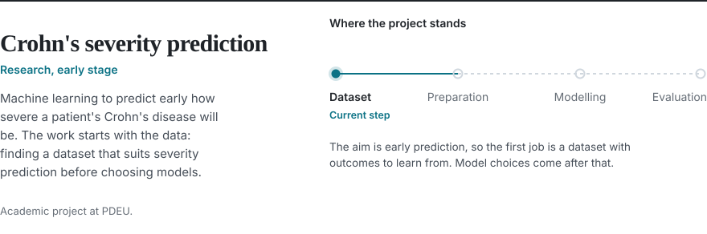

<picture>
  <source media="(prefers-color-scheme: dark)" srcset="assets/header-dark.svg">
  
</picture>

[Portfolio](https://hil-portfolio.vercel.app/) &nbsp;|&nbsp; [LinkedIn](https://www.linkedin.com/in/hil-kalathiya-47679331b)

I'm looking for machine learning internships for 2026–27.

## Selected work

<a href="https://github.com/HilKalathiya/HospitalOps-AI">
<picture>
  <source media="(prefers-color-scheme: dark)" srcset="assets/hospitalops-dark.svg">
  
</picture>
</a>

 

<a href="https://github.com/HilKalathiya/open-env-nuclei">
<picture>
  <source media="(prefers-color-scheme: dark)" srcset="assets/openenv-dark.svg">
  
</picture>
</a>

[Try the OpenEnv live demo](https://chetangadhiya017-data-cleaning-env.hf.space)

 

<picture>
  <source media="(prefers-color-scheme: dark)" srcset="assets/crohns-dark.svg">
  
</picture>

## Other projects

| Project | What it does | Built with |
| --- | --- | --- |
| [MDT AI Copilot](https://github.com/HilKalathiya/MDT-AI-Copilot) | Anomaly detection, signal forecasting and a natural-language assistant over 5G measurement data, built on OpenAirInterface. | Python, LangGraph, scikit-learn, Chroma, FastAPI |
| [Misinformation AI](https://github.com/HilKalathiya/misinformation_ai_hil) | AI-powered tool for combating misinformation. Team project with AI Gyani. | TypeScript, Python |
| Senso Gown | Patient vitals monitor with a live dashboard and SMS alerts. | ESP8266, sensors, MySQL, Twilio |

## Skills

| Area | Tools |
| --- | --- |
| Machine learning | scikit-learn, pandas, NumPy, ARIMA, Prophet, reinforcement learning |
| LLM systems | LangGraph, LangChain, RAG, Chroma, Cohere, OpenRouter, Llama 3 |
| Backend | Python, FastAPI, Node.js, MongoDB, MySQL, SQLite, Redis, Docker |
| Frontend | React, Next.js, TypeScript, Tailwind CSS, Vite |
| Fundamentals | Data structures and algorithms, object-oriented design, C++, SQL, Git |

## Recognition

- Smart India Hackathon: Top 25 in 2024 and again in 2025
- NPTEL Deep Learning, Elite certification
- ISRO-IIRS certification in AI and ML
