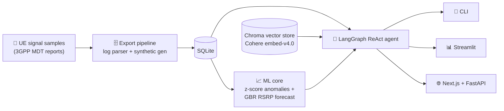

<!-- ===================== HEADER ===================== -->
<div align="center">


<a href="https://git.io/typing-svg">
  
</a>

<br/>

[](https://hil-portfolio.vercel.app/)
[](https://www.linkedin.com/in/hil-kalathiya-47679331b)


</div>

---

## 👋 About me

I'm a **B.Tech ICT student at Pandit Deendayal Energy University (PDEU), Gandhinagar** (graduating **2027**, CGPA ≈ 8.5), working at the intersection of **machine learning, agentic AI, and product thinking**.

I like problems where the data is messy, the stakes are real, and a plain model isn't enough, so the system has to *decide*, *retrieve*, and *explain*. My projects tend to share one pattern: **take an existing, under-served system and add the intelligence layer it was missing.**

```python
class Hil:
    role      = "AI/ML Engineer in the making"
    focus     = ["Agentic RAG", "Reinforcement Learning", "Time-series forecasting"]
    strengths = ["DSA", "OOP", "Python", "Backend APIs"]
    mindset   = "Simplicity scales. Clarity wins. Engineering is responsibility."
    now       = "Building hospital-ops AI and an ML model for early Crohn's severity prediction"
```

---

## 🏆 Highlights

| | |
|---|---|
| 🥇 **Smart India Hackathon** | Top 25, two years running (**2024 & 2025**) |
| 🧠 **NPTEL** | Deep Learning, *Elite* certification |
| 🛰️ **ISRO-IIRS** | AI/ML certification |
| 🦈 **GitHub** | Pull Shark · Quickdraw |

---

## ⭐ Flagship project

### 📡 MDT AI Copilot: agentic RAG on a 5G measurement pipeline

> Built on top of a real 5G/6G research-internship codebase (OpenAirInterface RRC stack). The original system stored signal reports **only in gNB memory**, so they were lost on restart. I added the **entire analytics layer**: persistence, ML, and a natural-language copilot.



| Gap in the existing system | What I built | Result |
|---|---|---|
| Data lost on gNB restart | SQLite export pipeline (log parser + seeded synthetic generator) | Persistent, ML-ready data |
| Fixed 3 dB / −100 dBm thresholds | Per-UE **rolling z-score** anomaly detector | Adapts to each UE's baseline; **recall ≥ 80%** on injected anomalies |
| No forecasting | Lag-feature **GradientBoosting** RSRP predictor | **Beats the naive baseline** on held-out MAE |
| Understanding behavior meant reading C | **Agentic RAG copilot**: the agent decides per question between SQL tools, doc retrieval, both, or neither | Grounded answers, with a cap on tool calls and truncated tool output |

**Why agentic and not naive RAG?** Questions here are heterogeneous. A data question needs SQL, a conceptual one needs docs, and a hybrid needs both. An agent routes per question instead of always retrieving.

<p>
  
  &nbsp;·&nbsp; LangGraph · scikit-learn · Chroma · Cohere · Streamlit · Plotly
</p>

[**→ View repository**](https://github.com/HilKalathiya/MDT-AI-Copilot)

---

## 🧩 More projects

<table>
<tr>
<td width="50%" valign="top">

### 🧹 OpenEnv: RL + LLM data cleaning agent
An agent that **learns how to clean data** instead of following hard-coded rules. An LLM (Llama 3) picks cleaning actions inside a custom RL environment with **shaped rewards** and an **anti-loop penalty** that stops reward-neutral cycles.

`Python` `FastAPI` `Llama 3` `Docker` `Hugging Face Spaces`

🤝 Co-built with [Chetan Gadhiya](https://github.com/chetangadhiya5062) and Sahaj Saliya
[🚀 Live demo](https://chetangadhiya017-data-cleaning-env.hf.space) · [Repo](https://github.com/HilKalathiya/open-env-nuclei)

</td>
<td width="50%" valign="top">

### 🏥 HospitalOps AI (in progress)
A hospital **operations decision-support** platform. It has RBAC-secured APIs, historical data ingestion, a live capacity dashboard, and a walk-forward ML pipeline with **baseline, ARIMA and Prophet forecasting** for admission and ICU demand.

**Next:** LSTM forecasting → what-if simulation → MIP resource optimization → multi-agent orchestration with human-in-the-loop approval.

`FastAPI` `React` `TypeScript` `MongoDB` `Redis` `Docker`

[Repo](https://github.com/HilKalathiya/HospitalOps-AI)

</td>
</tr>
<tr>
<td width="50%" valign="top">

### 📰 Misinformation AI (team *AI Gyani*)
An AI-powered tool for combating misinformation, built as a full-stack project with a TypeScript frontend and a Python backend.

`TypeScript` `Python`

[Repo](https://github.com/HilKalathiya/misinformation_ai_hil)

</td>
<td width="50%" valign="top">

### 🩺 Crohn's severity prediction (research)
An ongoing academic ML project on **early prediction of Crohn's disease severity**, currently at the dataset-discovery and problem-framing stage.

`Machine Learning` `Healthcare`

</td>
</tr>
</table>

> 🔌 **Where I started:** embedded and IoT, including *Senso Gown*, a smart healthcare vitals monitor (ESP8266, sensors, live dashboard, SMS alerts). That hardware-to-software background still shapes how I think about real-time data.

---

## 🛠️ Toolbox

<div align="center">

**Languages**


**AI / ML & Data**


LangGraph · LangChain · RAG · Chroma · Cohere · OpenRouter · Prophet · ARIMA

**Backend & Infra**


**Frontend**


</div>

---

## 📊 GitHub stats

<div align="center">


</div>

---

## 🎯 Currently

- 🔭 Taking **HospitalOps AI** from statistical forecasting to deep learning, simulation and optimization
- 🧪 Exploring datasets for **early Crohn's severity prediction**
- 🤖 Going deeper into **agentic systems**: tool routing, guardrails, evaluation
- 🎓 Looking for **ML / AI internships and research collaborations** for 2026–27

## 💬 Let's connect

If you're building something ambitious or solving a real-world problem with AI, I'd like to hear about it.
Reach me on [LinkedIn](https://www.linkedin.com/in/hil-kalathiya-47679331b) or through my [portfolio](https://hil-portfolio.vercel.app/).

<div align="center">


</div>
