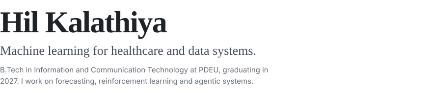
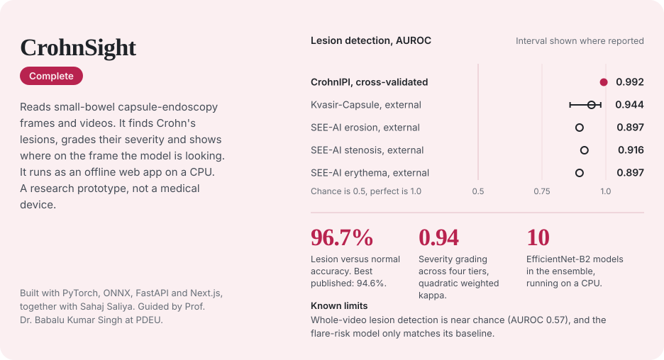
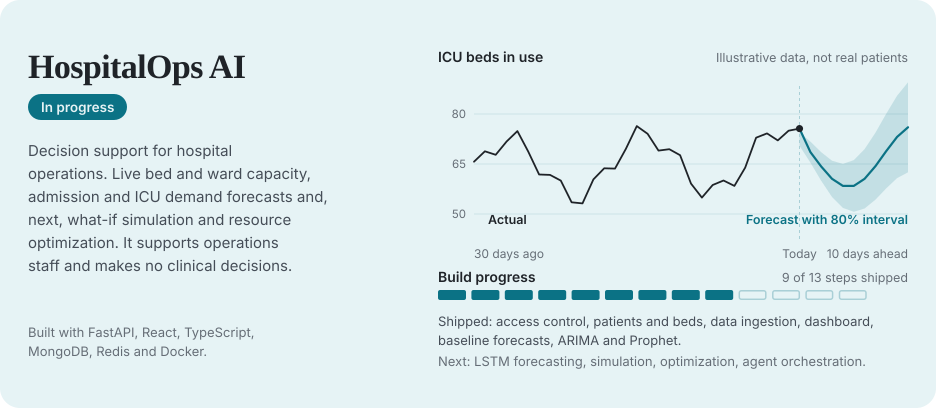
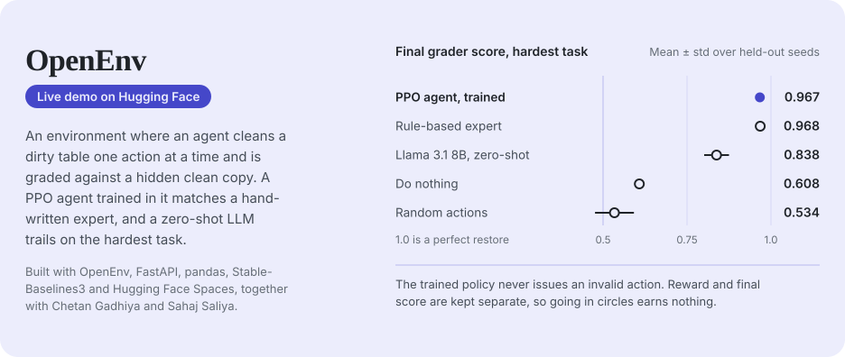
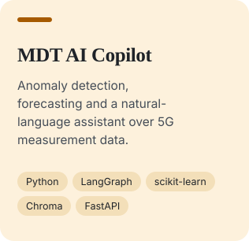
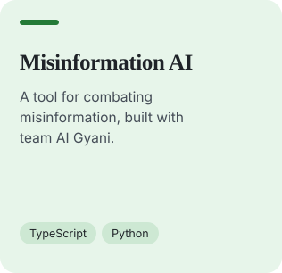
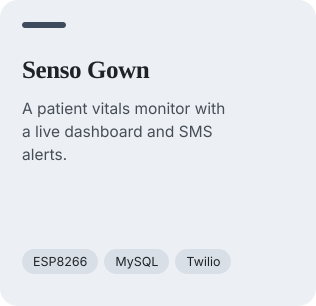
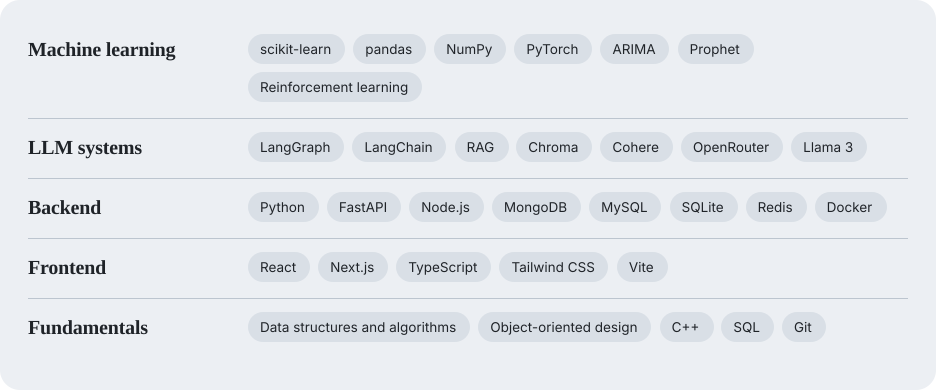
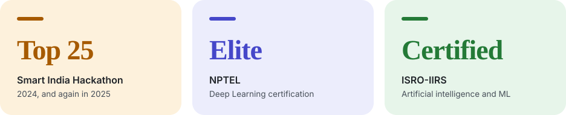

<picture>
  <source media="(prefers-color-scheme: dark)" srcset="assets/header-dark.svg">
  
</picture>

[hilkalathiya@gmail.com](mailto:hilkalathiya@gmail.com) &nbsp;·&nbsp; [Portfolio](https://hilkalathiya.github.io/Potfolio/) &nbsp;·&nbsp; [LinkedIn](https://www.linkedin.com/in/hil-kalathiya-47679331b)

<picture>
  <source media="(prefers-color-scheme: dark)" srcset="assets/h-selected-dark.svg">
  
</picture>

<a href="https://github.com/HilKalathiya/Crohn-Disease-Early-Prediction"><picture><source media="(prefers-color-scheme: dark)" srcset="assets/crohnsight-dark.svg"></picture></a>

<a href="https://github.com/HilKalathiya/HospitalOps-AI"><picture><source media="(prefers-color-scheme: dark)" srcset="assets/hospitalops-dark.svg"></picture></a>

<a href="https://github.com/HilKalathiya/open-env-nuclei"><picture><source media="(prefers-color-scheme: dark)" srcset="assets/openenv-dark.svg"></picture></a>

[Try the OpenEnv live demo](https://chetangadhiya017-data-cleaning-env.hf.space)

<picture>
  <source media="(prefers-color-scheme: dark)" srcset="assets/h-also-dark.svg">
  
</picture>

<a href="https://github.com/HilKalathiya/MDT-AI-Copilot"><picture><source media="(prefers-color-scheme: dark)" srcset="assets/card-mdt-dark.svg"></picture></a>
<a href="https://github.com/HilKalathiya/misinformation_ai_hil"><picture><source media="(prefers-color-scheme: dark)" srcset="assets/card-misinfo-dark.svg"></picture></a>
<a href="https://github.com/HilKalathiya/IoT-Workshop-hackethon"><picture><source media="(prefers-color-scheme: dark)" srcset="assets/card-senso-dark.svg"></picture></a>

<picture>
  <source media="(prefers-color-scheme: dark)" srcset="assets/h-skills-dark.svg">
  
</picture>

<picture>
  <source media="(prefers-color-scheme: dark)" srcset="assets/skills-dark.svg">
  
</picture>

<picture>
  <source media="(prefers-color-scheme: dark)" srcset="assets/h-recog-dark.svg">
  
</picture>

<picture>
  <source media="(prefers-color-scheme: dark)" srcset="assets/recognition-dark.svg">
  
</picture>
