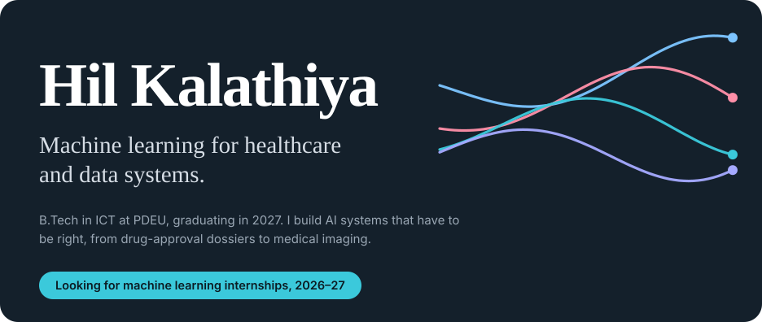
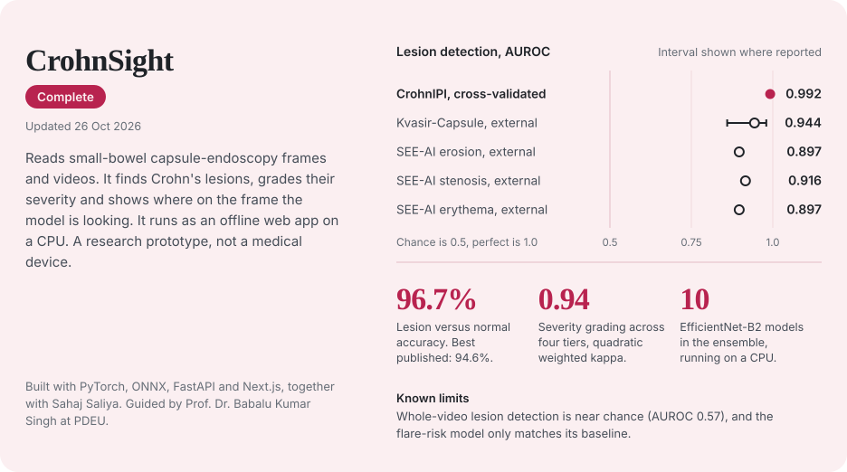
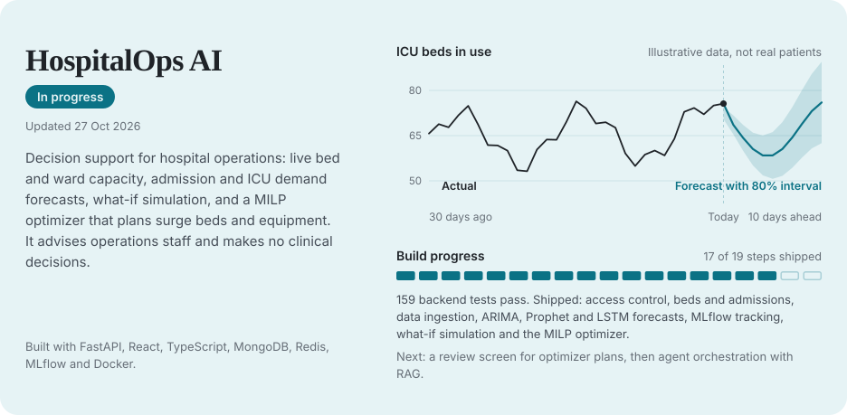
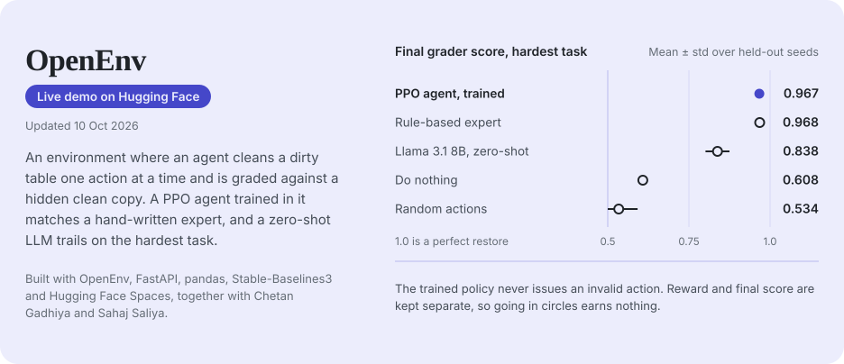
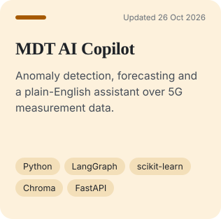
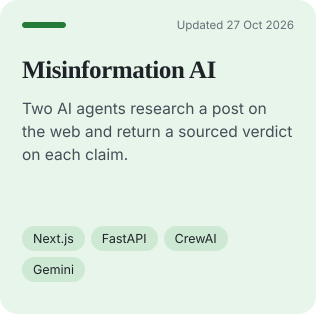
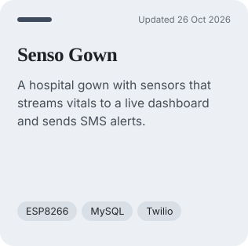
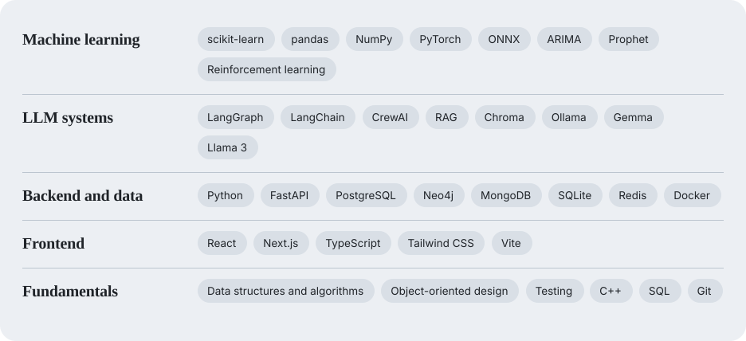
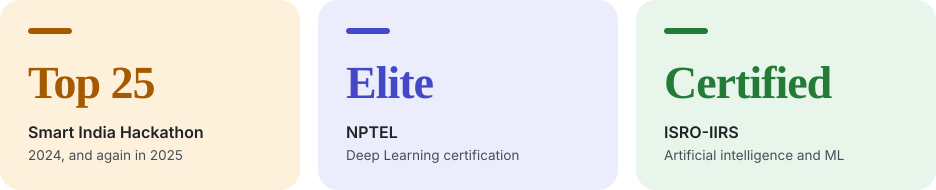

<!-- Generated by tools/build.py from showcase.yml. Edit showcase.yml, not this file. -->

<picture><source media="(prefers-color-scheme: dark)" srcset="assets/header-dark.svg"></picture>

[hilkalathiya@gmail.com](mailto:hilkalathiya@gmail.com) &nbsp;·&nbsp; [Portfolio](https://hilkalathiya.github.io/Potfolio/) &nbsp;·&nbsp; [LinkedIn](https://www.linkedin.com/in/hil-kalathiya-47679331b)

<picture><source media="(prefers-color-scheme: dark)" srcset="assets/h-selected-dark.svg"></picture>

<a href="https://github.com/HilKalathiya/eCTD-Compilation-Audit-Platform"><picture><source media="(prefers-color-scheme: dark)" srcset="assets/p-ectd-compilation-audit-platform-dark.svg"></picture></a>

[Read the technical brief](https://github.com/HilKalathiya/eCTD-Compilation-Audit-Platform/blob/main/AI%20Evidence%20Engine%20for%20Drug%20Approval%20Dossiers%20%E2%80%94%20Technical%20Brief.md)

<a href="https://github.com/HilKalathiya/Crohn-Disease-Early-Prediction"><picture><source media="(prefers-color-scheme: dark)" srcset="assets/p-crohn-disease-early-prediction-dark.svg"></picture></a>

<a href="https://github.com/HilKalathiya/HospitalOps-AI"><picture><source media="(prefers-color-scheme: dark)" srcset="assets/p-hospitalops-ai-dark.svg"></picture></a>

<a href="https://github.com/HilKalathiya/open-env-nuclei"><picture><source media="(prefers-color-scheme: dark)" srcset="assets/p-open-env-nuclei-dark.svg"></picture></a>

[Try the OpenEnv live demo](https://chetangadhiya017-data-cleaning-env.hf.space)

<picture><source media="(prefers-color-scheme: dark)" srcset="assets/h-also-dark.svg"></picture>

<a href="https://github.com/HilKalathiya/MDT-AI-Copilot"><picture><source media="(prefers-color-scheme: dark)" srcset="assets/c-mdt-ai-copilot-dark.svg"></picture></a>
<a href="https://github.com/HilKalathiya/misinformation_ai_hil"><picture><source media="(prefers-color-scheme: dark)" srcset="assets/c-misinformation_ai_hil-dark.svg"></picture></a>
<a href="https://github.com/HilKalathiya/IoT-Workshop-hackethon"><picture><source media="(prefers-color-scheme: dark)" srcset="assets/c-iot-workshop-hackethon-dark.svg"></picture></a>

<picture><source media="(prefers-color-scheme: dark)" srcset="assets/h-skills-dark.svg"></picture>

<picture><source media="(prefers-color-scheme: dark)" srcset="assets/skills-dark.svg"></picture>

<picture><source media="(prefers-color-scheme: dark)" srcset="assets/h-recog-dark.svg"></picture>

<picture><source media="(prefers-color-scheme: dark)" srcset="assets/recognition-dark.svg"></picture>
