

<a href="https://hil-portfolio.vercel.app/"></a>

  

&nbsp;&nbsp;

  

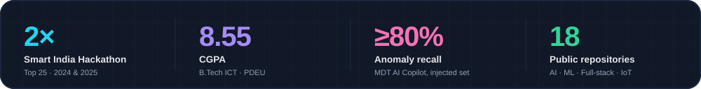

 

**B.Tech ICT student at PDEU (Class of 2027)** who builds AI systems that don't just predict, they **retrieve, reason and act**. I like messy, real-world problems: take an existing system that's missing its intelligence layer, and build it.

 

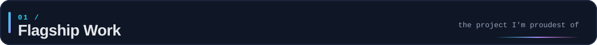

  

<a href="https://github.com/HilKalathiya/MDT-AI-Copilot"></a>

  

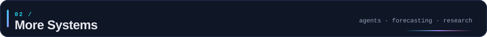

  

<table>
<tr>
<td width="50%" valign="top"><a href="https://github.com/HilKalathiya/open-env-nuclei"></a></td>
<td width="50%" valign="top"><a href="https://github.com/HilKalathiya/HospitalOps-AI"></a></td>
</tr>
<tr>
<td width="50%" valign="top"><a href="https://github.com/HilKalathiya/misinformation_ai_hil"></a></td>
<td width="50%" valign="top"></td>
</tr>
</table>

OpenEnv: <a href="https://chetangadhiya017-data-cleaning-env.hf.space">live demo ↗</a> · co-built with <a href="https://github.com/chetangadhiya5062">Chetan Gadhiya</a> and Sahaj Saliya

 

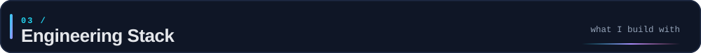

  

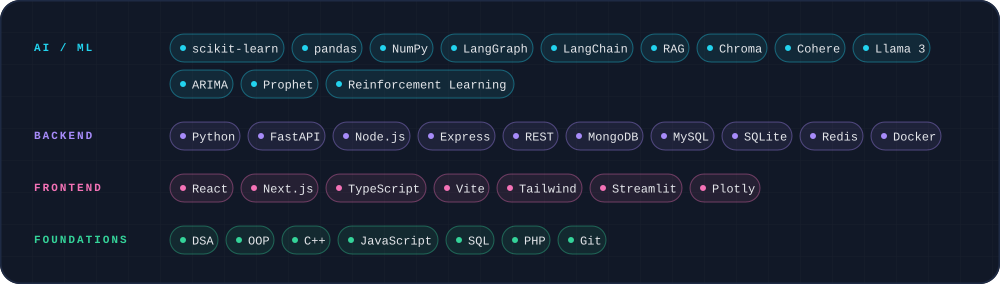

  

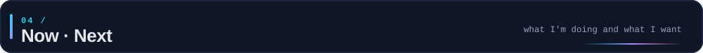

  


  

&nbsp;&nbsp;

  

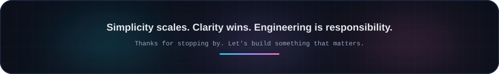

